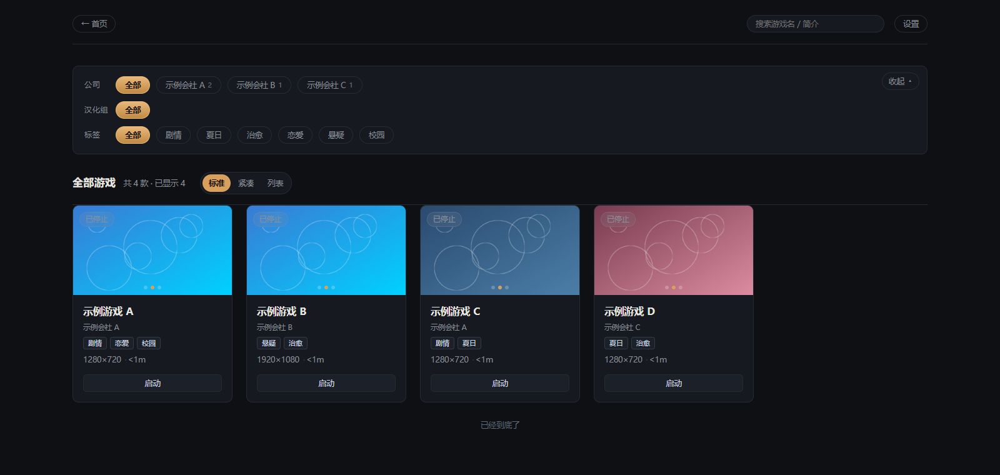
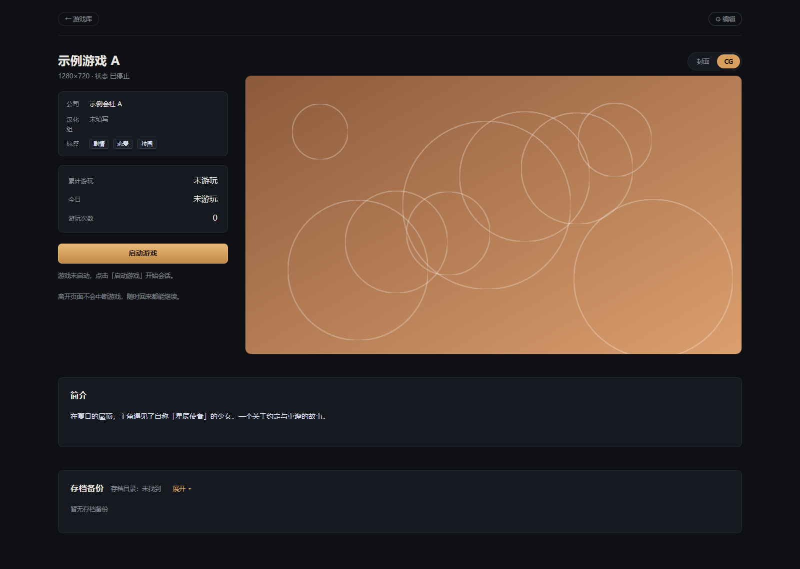
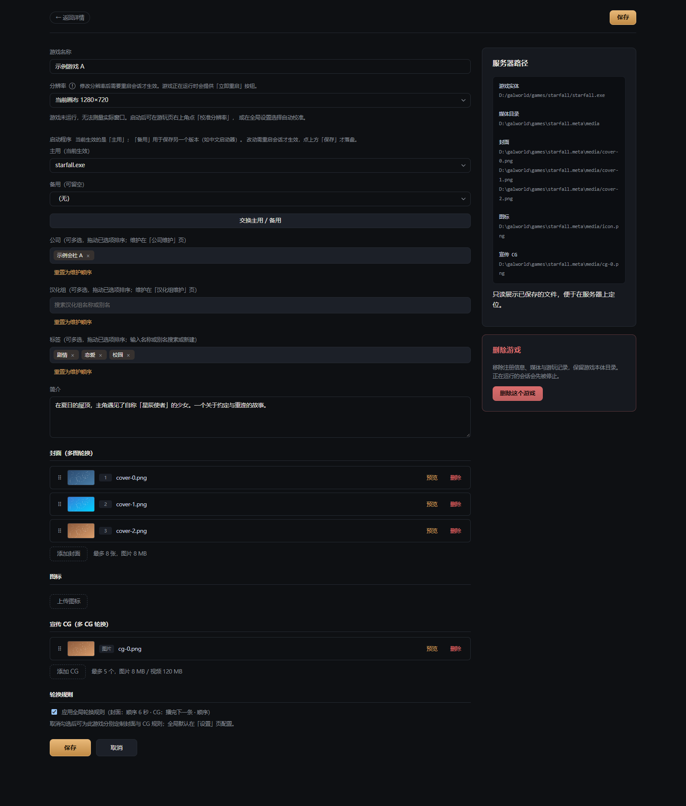

# Gal World

English | [简体中文](README.zh-CN.md)

A self-hosted cloud gaming platform for Windows visual novels (galgames): deploy games to a Linux or
Windows host and play them in a browser. The portal owns the game library, metadata, sessions, media,
saves and operations; streaming is handled by Selkies (Linux) or Sunshine + Moonlight Web (Windows).

Latest release: `0.0.1`. Version number lives only in `portal/pom.xml`.

Released under the [MIT License](LICENSE). This is a solution built around personal needs, not a
commercial product; self-hosting, issues and PRs are welcome, but no out-of-the-box guarantee.

## Features

- **Browser play** — Selkies on Linux, Sunshine + Moonlight Web on Windows
- **Isolated games** — per-game wine prefix, Xvfb display, ALSA subdevice, audio chain and port
- **Sessions survive disconnects** — closing the browser does not stop the game
- **Library** — hero picks, filters by company / localization group / tag, search, quick start-stop
- **Import wizard** — upload zip / 7z or a folder (chunked, resumable), or use a server directory
- **Metadata and media** — companies / groups / tags, covers, icons, CG rotation, image preloading
- **Saves** — tagged backups, one-click switching, five safety guards, automatic original snapshot
- **Operations** — one-click deploy / uninstall with live logs, remote update with rollback,
  config snapshots, game package download
- **Playback extras** — heartbeat playtime, idle stop, canvas calibration, latency display, telemetry

## Screenshots



| Game detail | Game edit |
|---|---|
|  |  |

Sample data only; screenshots contain no game assets.

## Requirements

| Item | Requirement |
|---|---|
| JDK / Node / Maven | 17+ / 20+ / 3.9+ |
| Linux | Ubuntu 22.04+ / 24.04, Wine 9.0, PulseAudio, snd-aloop, Xvfb, Selkies |
| Windows | Windows 10 1903+ / 11 (x64), Sunshine, Moonlight Web, virtual audio cable |

## Build and run

```bash
# Build the frontend and the single jar
cd portal/frontend && npm ci && npm run build
cd .. && mvn -DskipTests package
# Artifact: portal/target/gal-world-portal-<version>.jar

# Linux: bootstrap base environment, then open https://<host>:8088/
./deploy.sh

# Windows (Administrator PowerShell)
.\deploy\win\install.ps1 -Jar ..\portal\target\gal-world-portal-<version>.jar
```

HTTPS is required: the play page embeds a WebCodecs-based stream that needs a secure context.

Development: backend `GALWORLD_PORTAL_PORT=8080 mvn spring-boot:run` under `portal/`; frontend
`npm run dev` under `portal/frontend/` on `:5173`. Tests: `mvn test`, `npm test && npm run check:theme`.

## Usage

1. Open `https://<host>:8088/`; `deploy.sh` prints the deploy token when it finishes.
2. Enter the token under **Admin** to unlock environment info and one-click deploy.
3. Run **Environment info → One-click deploy** to install Wine / Selkies / the audio chain.
4. Import a game under **Games → Import** (upload an archive or folder, or pick a server directory).
5. Start it from the library card and play it on `/play/<id>`.

Commands: `./deploy.sh --skip-deps` (setup only), `./uninstall.sh --dry-run` (preview removal),
`GITEE_TOKEN=<token> bash deploy/release.sh` (publish a release).

## Documentation

- [`docs/CONFIGURATION.md`](docs/CONFIGURATION.md) — environment variables and credentials files
- [`docs/OPERATIONS.md`](docs/OPERATIONS.md) — deployment details, uninstall, update, recovery, limits
- [`docs/PORTAL.md`](docs/PORTAL.md) — routes, playtime, canvas calibration, media
- [`docs/ENVIRONMENT.md`](docs/ENVIRONMENT.md) — environment probing, Linux / Windows setup
- [`docs/GAME-IMPORT-PLAN.md`](docs/GAME-IMPORT-PLAN.md) — import wizard design
- [`CONTRIBUTING.md`](CONTRIBUTING.md) · [`SECURITY.md`](SECURITY.md) ·
  [`CODE_OF_CONDUCT.md`](CODE_OF_CONDUCT.md) · [`CHANGELOG.md`](CHANGELOG.md)
- [`THIRD-PARTY-NOTICES.md`](THIRD-PARTY-NOTICES.md) — bundled dependencies and licenses

## License

MIT. Game content, localization patches and in-game assets belong to their original authors and are not
included. Third-party components and their license texts are listed in
[`THIRD-PARTY-NOTICES.md`](THIRD-PARTY-NOTICES.md) and [`licenses/`](licenses/).

AI coding agents should read [`AGENTS.md`](AGENTS.md) before changing anything.
