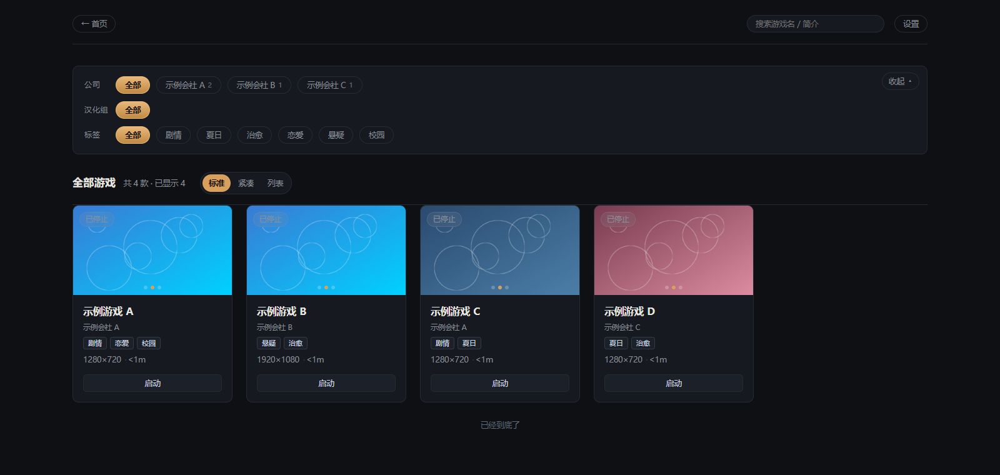
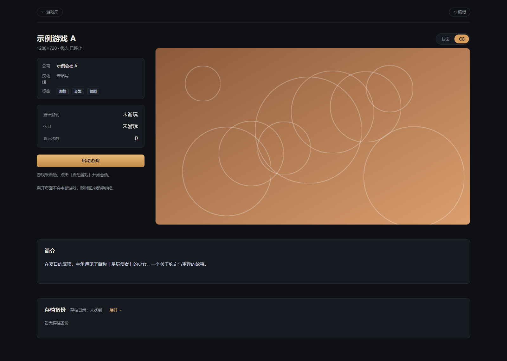
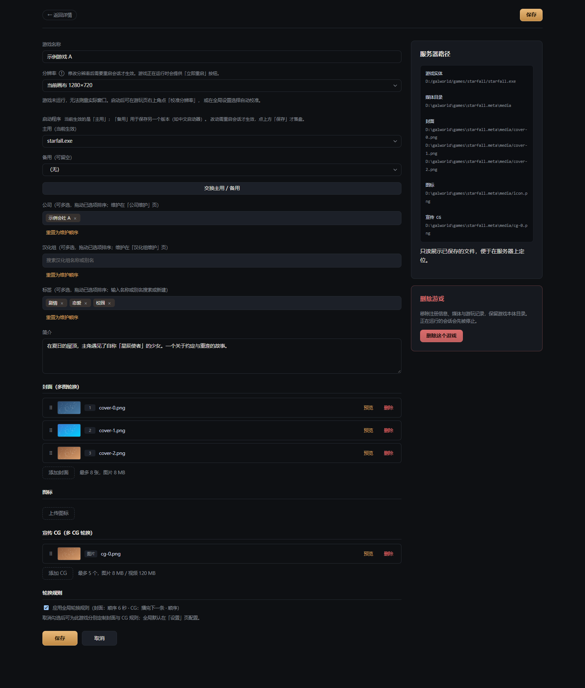

# Gal World

[English](README.md) | 简体中文

自建云游戏平台：把 Windows 视觉小说（galgame）部署到 Linux 或 Windows 主机，通过浏览器串流游玩。
门户负责游戏库、元数据、会话、媒体、存档与运维；串流由 Selkies（Linux）或 Sunshine + Moonlight
Web（Windows）承担。

当前版本 `0.0.1`，版本号唯一来源是 `portal/pom.xml`。

项目以 [MIT 许可证](LICENSE) 开源。它是按个人需求长出来的自建方案，不是商业产品；
欢迎自建部署、提 issue 与 PR，但不承诺开箱即用或向后兼容。

## 能力

- **浏览器游玩**：Linux 走 Selkies，Windows 走 Sunshine + Moonlight Web
- **资源隔离**：每游戏独立 wine prefix、Xvfb 显示、ALSA 子设备、音频链与端口
- **断线不掉**：关闭浏览器不终止游戏会话，回来继续
- **游戏库**：Hero 推荐、公司 / 汉化组 / 标签筛选、搜索、卡片快捷启停
- **接入向导**：上传 zip / 7z 或整个文件夹（分片、可续传），也可选服务器已有目录
- **元数据与媒体**：公司 / 汉化组 / 标签、封面、图标、CG 轮换、图片预加载
- **存档**：带标签备份、一键切换、五道安全保护、接入时自动留「原始」存档
- **运维**：一键部署 / 彻底卸载（实时日志）、远程更新（校验 + 回滚）、配置快照、游戏打包下载
- **游玩体验**：心跳计时、空闲自动停止、画面校准、时延显示、崩溃遥测

## 界面



| 游戏详情 | 游戏编辑 |
|---|---|
|  |  |

截图使用示例数据，不含任何作品素材。

## 环境要求

| 项 | 要求 |
|---|---|
| JDK / Node / Maven | 17+ / 20+ / 3.9+ |
| Linux | Ubuntu 22.04+ / 24.04，Wine 9.0、PulseAudio、snd-aloop、Xvfb、Selkies |
| Windows | Windows 10 1903+ / 11（x64），Sunshine、Moonlight Web、虚拟声卡 |

## 构建与启动

```bash
# 构建前端与单 jar
cd portal/frontend && npm ci && npm run build
cd .. && mvn -DskipTests package
# 产物：portal/target/gal-world-portal-<version>.jar

# Linux：准备基础环境，然后访问 https://<host>:8088/
./deploy.sh

# Windows（管理员 PowerShell）
.\deploy\win\install.ps1 -Jar ..\portal\target\gal-world-portal-<version>.jar
```

必须 HTTPS：游玩页内嵌基于 WebCodecs 的串流，要求安全上下文。

开发：后端在 `portal/` 下 `GALWORLD_PORTAL_PORT=8080 mvn spring-boot:run`；
前端在 `portal/frontend/` 下 `npm run dev`（:5173）。测试：`mvn test`、
`npm test && npm run check:theme`。

## 用法

1. 访问 `https://<host>:8088/`；`deploy.sh` 结束时打印部署令牌。
2. 在「管理」页填令牌，解锁环境信息与一键部署。
3. 跑「环境信息 → 一键部署」安装 Wine / Selkies / 音频链。
4. 在「游戏 → 接入」导入游戏（上传压缩包 / 文件夹，或选服务器目录）。
5. 在库卡片上启动，进入 `/play/<id>` 游玩。

常用命令：`./deploy.sh --skip-deps`（只做基础环境）、`./uninstall.sh --dry-run`（预览删除）、
`GITEE_TOKEN=<token> bash deploy/release.sh`（发布 Release）。

## 文档

- [`docs/CONFIGURATION.md`](docs/CONFIGURATION.md)：环境变量与凭据文件
- [`docs/OPERATIONS.md`](docs/OPERATIONS.md)：部署细节、卸载、更新、恢复与已知限制
- [`docs/PORTAL.md`](docs/PORTAL.md)：门户路由、时长口径、画面校准、媒体
- [`docs/ENVIRONMENT.md`](docs/ENVIRONMENT.md)：环境探测、Linux / Windows 部署
- [`docs/GAME-IMPORT-PLAN.md`](docs/GAME-IMPORT-PLAN.md)：接入向导设计
- [`CONTRIBUTING.md`](CONTRIBUTING.md) · [`SECURITY.md`](SECURITY.md) · [`CHANGELOG.md`](CHANGELOG.md)
- [`THIRD-PARTY-NOTICES.md`](THIRD-PARTY-NOTICES.md)：随发布物分发的第三方组件与许可证

## 许可

MIT。游戏本体、汉化补丁与游戏内素材版权归原作者，不包含在本仓库中。
第三方组件及许可证全文见 [`THIRD-PARTY-NOTICES.md`](THIRD-PARTY-NOTICES.md) 与
[`licenses/`](licenses/)。

用 AI 编码代理改动本项目时，先读 [`AGENTS.md`](AGENTS.md)。
